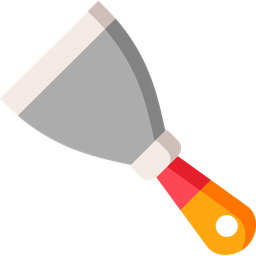
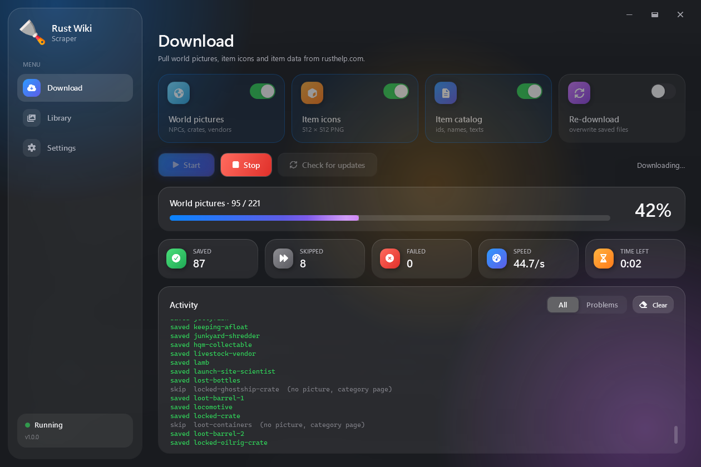
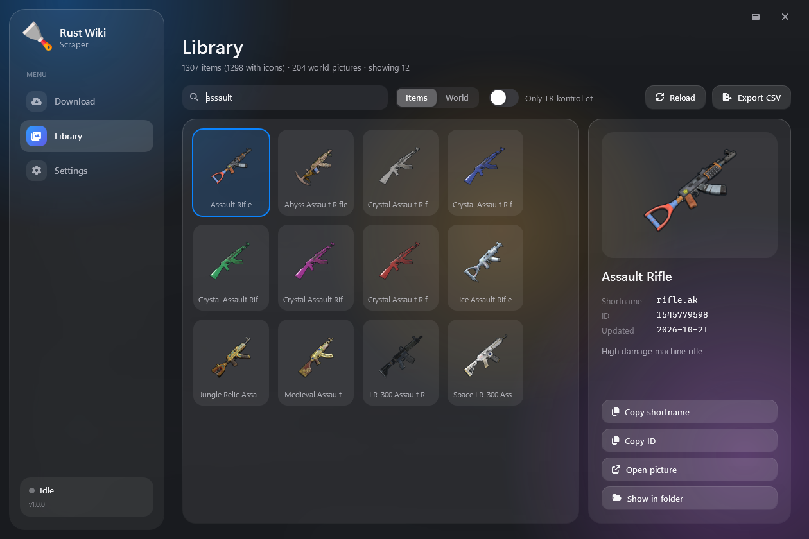
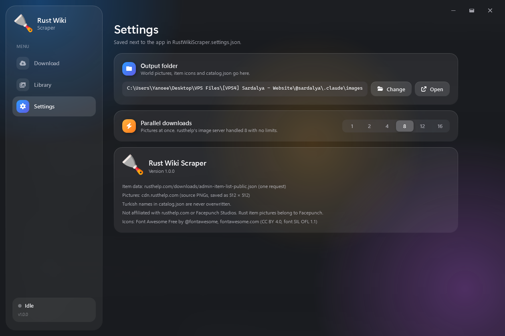

<p align="center">
  
</p>

<p align="center">
  
</p>

<p align="center">
  
</p>

<p align="center">
  
  
  
  
</p>

<p align="center">
  <a href="../../releases/latest"></a>
</p>

<p align="center">
  
</p>

## What it is

A Windows app that downloads every Rust item icon, every world picture and the full item list from rusthelp.com, then files them into folders with a JSON file next to them.

I made it because I was bored and my Rust server's icons were a mess. A folder and twenty minutes would have fixed that. I went with this instead.

It could have scraped the whole wiki. Loot tables, recipes, raid costs, all of it. It doesn't. I keep that power under control.

## What it does

- Every item icon as a 512 × 512 PNG named by shortname. About 1,300 of them in roughly thirty seconds.
- World pictures. NPCs, crates, vendors. Around 200. You will use four.
- `catalog.json` with every item's in-game ID, name and description, plus a field for your own translation that it never touches.
- Notices when rusthelp renames something, so your translation doesn't quietly go stale.
- Checks what changed on rusthelp without downloading anything, for when you want to know but not commit.
- A library to browse everything you hoarded. Search it, copy IDs, export it to CSV, look at it.
- Frosted glass, floating icons, buttons that wobble. None of it was needed.

<p align="center">
  
</p>

## Using it

Grab `RustWikiScraper.exe` from Releases. Run it. Press Start.

Everything ends up next to the exe. No installer, no runtime, no account. That is the entire manual.

## catalog.json

```json
"rifle.ak": {
  "id": 1545779598,
  "name": { "en": "Assault Rifle", "tr": "Saldırı Tüfeği" },
  "desc": { "en": "High damage machine rifle.", "tr": "" },
  "icon": { "src": "rifle.ak.png", "sha256": "...", "updated": "2026-10-22" },
  "tr_check": false,
  "removed": false
}
```

- `en` always comes from rusthelp.
- `tr` is yours. Fill it, ignore it, it stays the way you left it.
- `tr_check` flips to `true` when the English name changes under you.
- Items rusthelp drops get `removed: true`. Nothing is ever deleted.

## Source

It's all here. Build it, fork it, rewrite it in Rust for the irony. I don't really care what you do with it.

<p align="center">
  
</p>

## Questions nobody asked

**Is this necessary?**
No.

**Why a desktop app?**
It seemed like the most effort.

**Will it get updates?**
If I get bored again. Historically, I do.

**Linux? Mac?**
No.

## Credits

Data and pictures come from [rusthelp.com](https://rusthelp.com). Rust and its artwork belong to Facepunch Studios. This project has nothing to do with either of them.

Icons are [Font Awesome Free](https://fontawesome.com) (CC BY 4.0, font under SIL OFL 1.1).

MIT licensed.

<p align="center">
  
</p>
